# opti-inven-ops

## Reproducible supply-chain analytics and a DuckDB data platform

A Python project connecting demand analysis, inventory decisions, perishable-stock economics and warehouse dock capacity with a reproducible ingestion-to-export data pipeline.

The case study uses Nordpack GmbH, a fictional FMCG distributor, and three years of synthetic weekly demand for six product archetypes.

The project combines two complementary layers:

- Operations research: demand decomposition, inventory optimisation, newsvendor analysis, queueing models and scenario-based risk analysis.
- Data engineering: CSV ingestion, quality checks, DuckDB tables, persistent run records, Power BI-ready exports, Docker execution and GitHub Actions validation.

All financial results are modelled estimates under stated assumptions—not realised business savings.

---

## Contents

- [Business questions](#business-questions)
- [Architecture](#architecture)
- [Data and assumptions](#data-and-assumptions)
- [Reference results](#reference-results)
- [Understanding the models](#understanding-the-models)
- [Complete visual walkthrough](#complete-visual-walkthrough)
- [Run locally](#run-locally)
- [Run with Docker](#run-with-docker)
- [Data platform outputs](#data-platform-outputs)
- [Testing and validation](#testing-and-validation)
- [Limitations](#limitations)
- [Project structure](#project-structure)
- [Further documentation](#further-documentation)

---

## Business questions

The analysis addresses six connected decisions:

1. Which products have stable, seasonal, promotional or intermittent demand?
2. How should order quantities and reorder points change when shortages carry a penalty?
3. How do cycle service level and unit fill rate lead to different inventory requirements?
4. How much fresh bread should be ordered when unsold units lose value?
5. Would an additional dock door reduce waiting costs enough to justify investment?
6. How sensitive are the modelled decisions to uncertain costs, demand and lead times?

The aim is to make each decision traceable from assumptions to calculation, visual evidence and limitations.

---

## Architecture

```text
Source demand CSV
        |
        v
Ingestion and wide-to-long transformation
        |
        v
Data-quality validation
        |
        +-------------------------------+
        |                               |
        v                               v
DuckDB demand tables           Analytical Modules 1–6
                                        |
                                        v
                              Generated CSVs and charts
                                        |
                                        v
                              Analytics-table ingestion
                                        |
                                        v
                       Persistent run records and CSV exports
                                        |
                                        v
                              Power BI-ready local files
```

The analytical entry point is `python -m src.run_all`.

The platform entry point is `python -m data_platform.pipeline`.

These entry points serve different purposes: the first runs the analytical case study; the second orchestrates ingestion, analytics, warehouse creation and exports.

Power BI-ready exports are local CSV files. The project does not deploy a Power BI dataset, configure a gateway or publish a dashboard to the Power BI service.

---

## Data and assumptions

### Product archetypes

| SKU | Product | Modelled demand behaviour |
|---|---|---|
| A | Yoghurt | High-volume demand with a seasonal pattern and growth |
| B | Detergent | Relatively stable baseline with promotional spikes |
| C | Christmas cookies | Low baseline with concentrated seasonal demand |
| D | Specialty coffee | Lower-volume, comparatively stable demand |
| E | Fresh bread | Perishable demand with trend and seasonal variation |
| F | Industrial cleaning supplies | Intermittent demand with zero-demand weeks |

The simulation contains 156 weekly observations per SKU.

Synthetic data makes the data-generating process inspectable. It does not establish that the same parameters, model fit or financial benefits would hold in a real distribution centre.

### Key modelling assumptions

- Demand is measured in weekly units.
- Module 2 samples historical weekly demand with replacement to construct lead-time demand.
- Lead times are generated from a normal draw, rounded to whole weeks and floored at one week.
- This is a rounded-and-clipped normal construction, not a formally sampled truncated-normal distribution.
- Module 2's sampling does not preserve the chronological order of seasonal demand.
- Holding, ordering, shortage and dock-cost inputs are assumed case-study parameters.
- Bread's newsvendor analysis treats each week as a single selling period.
- The dock model assumes Poisson arrivals and exponential service times.
- Monte Carlo results depend on the implemented scenario distributions and approximations.

---

## Reference results

### How to interpret these numbers

The following values describe the supplied full-run reference charts.

They are not operational forecasts, and they should not be mixed with single-SKU test fixtures or alternate-run screenshots.

Some displayed values are rounded independently, so differences between rounded table entries may not exactly reproduce the separately rounded savings column.

### Inventory cost comparison

| SKU | EOQ, units | Joint Q*, units | Joint r*, units | Joint annual cost | Independent annual cost | Displayed saving |
|---|---:|---:|---:|---:|---:|---:|
| A — Yoghurt | 3,964 | 4,062 | 3,019 | €3,723 | €3,853 | €130 |
| B — Detergent | 3,433 | 3,591 | 2,448 | €4,143 | €4,385 | €243 |
| C — Christmas cookies | 1,048 | 1,236 | 1,064 | €2,069 | €2,089 | €20 |
| D — Coffee | 1,105 | 1,121 | 414 | €2,005 | €2,010 | €4 |
| E — Bread: comparability model only | 3,679 | 4,136 | 1,479 | €3,195 | €3,223 | €28 |
| F — Cleaning supplies | 702 | 760 | 400 | €2,152 | €2,159 | €7 |

The full-run chart reports approximately €433/year of combined inventory cost reduction.

The economic improvement is largest for detergent in this reference run. Coffee's improvement is small, illustrating why implementation effort should be compared with the size and uncertainty of the benefit.

Bread is included in Module 2 for comparison. Its dedicated perishable-stock decision is analysed separately in Module 3.

### Service-level interpretation

For yoghurt, the reference results show:

- Type 1 safety stock: approximately 1,073 units.
- Type 2 safety stock: approximately 158 units.
- Difference: approximately 915 units.

Across the six-SKU comparison, the model reports approximately €2,355/year of holding-cost difference.

This comparison evaluates different service definitions at the same numerical target. It is not evidence that Type 1 is inherently wrong or that Type 2 satisfies every retailer contract.

Do not automatically add this amount to joint-optimisation savings: the interventions affect related inventory decisions and use different comparison baselines.

### Perishable bread

| Policy | Weekly order | Expected waste/week | Expected unmet demand/week | Modelled annual profit |
|---|---:|---:|---:|---:|
| Newsvendor Q* | 1,187 | 65.7 | 49.7 | €41,600 |
| Mean-demand order | 1,171 | 57.7 | 57.7 | €41,520 |
| Median-demand order | 1,178 | 61.3 | 53.8 | €41,570 |
| 97.5th-percentile order | 1,456 | 285.2 | 0.2 | €32,387 |

Under the assumed costs, the newsvendor solution improves annual profit by approximately €9,213 relative to the 97.5th-percentile ordering policy.

The result illustrates a trade-off, not free improvement: lower waste is accompanied by greater unmet demand.

If a contractual service requirement must also be met, the decision must be formulated with that constraint. The unconstrained profit optimum is not automatically an SLA-compliant recommendation.

### Dock-capacity scenario

| Metric | Two doors | Three doors |
|---|---:|---:|
| Utilisation per door | 75% | 50% |
| Analytical mean queue wait | 38.6 minutes | 4.7 minutes |

Case-study investment assumptions:

- Capital expenditure: €180,000.
- Additional annual operating cost: €25,000.
- Evaluation horizon: 10 years.
- Discount rate: 8%.

The analytical case reports approximately:

- €274,906/year of gross waiting-cost reduction.
- €249,906/year after additional operating cost.
- 8.6-month simple payback.
- €1.497 million net present value.

These estimates are conditional on assumed throughput, waiting costs and queueing behaviour. They are not an approved capital investment case.

### Why there is no single headline “total benefit”

The project contains different baselines, overlapping inventory interventions and hard-coded executive-summary values.

A defensible combined benefit requires a reconciled intervention ledger with:

- One consistent baseline.
- Explicit intervention interactions.
- No double counting.
- Separation of profit gains, cost reductions, annual cash flows and NPV.
- Results linked to a specific generated run.

Until that reconciliation is implemented, the module-level results are more informative than a single aggregate benefit.

---

## Understanding the models

### 1. Demand decomposition

STL decomposes observed demand into:

```text
Observed demand = Trend + Seasonal component + Residual
```

The residual is what remains after the fitted trend and seasonal pattern have been removed.

A small residual does not prove that future demand is predictable. In-sample decomposition can absorb variation, particularly with only three annual cycles.

The reference residual charts show a concentration near zero and larger deviations in parts of the series. This requires diagnostic caution rather than a blanket conclusion that a particular distribution is correct.

### 2. Inventory optimisation

The inventory model balances:

```text
Annual cost = Ordering cost + Holding cost + Shortage cost
```

Its implemented approximation is:

```text
TC(Q,r) =
    (D/Q) × S
  + [Q/2 + r − E(LTD)] × H
  + (D/Q) × p × E[max(LTD − r, 0)]
```

Where:

- D: annual demand.
- Q: order quantity.
- r: reorder point.
- S: fixed ordering cost.
- H: annual holding cost per unit.
- p: shortage penalty per unit.
- LTD: lead-time demand.

EOQ minimises the ordering-plus-cycle-holding trade-off. The joint routine also considers expected shortages and the reorder-point decision.

The resulting cost optimum is not automatically constrained to achieve a 97.5% service target.

### 3. Two service definitions

Cycle service level asks:

> What proportion of replenishment cycles avoid a stockout?

Fill rate asks:

> What proportion of demanded units are supplied from stock?

The implemented fill-rate approximation is:

```text
Fill rate ≈ 1 − Expected shortage per cycle / Q
```

The same percentage can imply different inventory requirements because the two metrics count different outcomes.

Negative calculated safety stock means that the reorder point is below the mean lead-time demand under this formulation. Physical inventory is not negative.

### 4. Perishable inventory

The newsvendor decision uses:

```text
Critical ratio = Underage cost / (Underage cost + Overage cost)

Q* = Demand quantile at the critical ratio
```

For the reference bread case, the critical ratio is approximately 0.542.

The economic optimum balances the consequences of ordering too much against ordering too little. It does not minimise waste alone.

### 5. Dock queueing

For c identical dock doors:

```text
Utilisation = Arrival rate / (c × Service rate per door)
```

Erlang C provides the modelled probability of waiting and expected queue delay when the queue is stable.

As utilisation approaches one, expected waiting time rises sharply.

### 6. Scenario analysis

Module 5 compares an adaptive, re-optimised policy with a rule-based alternative under assumed parameter uncertainty.

Because the optimiser is rerun within scenarios, the outputs describe adaptive decision performance—not the out-of-sample robustness of one frozen policy selected today.

The implementation scales baseline lead-time-demand samples rather than fully resimulating every scenario.

The lead-time standard-deviation scenario array is generated but does not affect the scenario LTD transformation. Accordingly, these outputs should not be described as a complete propagation of lead-time variability uncertainty.

---

## Complete visual walkthrough

The main analytical source defines 28 canonical figures.

Two additional historical single-SKU images are retained separately at the end for provenance, bringing the documented visual collection to 30 without presenting duplicates as new findings.

Each section explains the graph elements and the conclusion that can reasonably be drawn.

<details>
<summary>Module 1 — Demand characterisation: 5 figures</summary>

### 1. Weekly demand overview

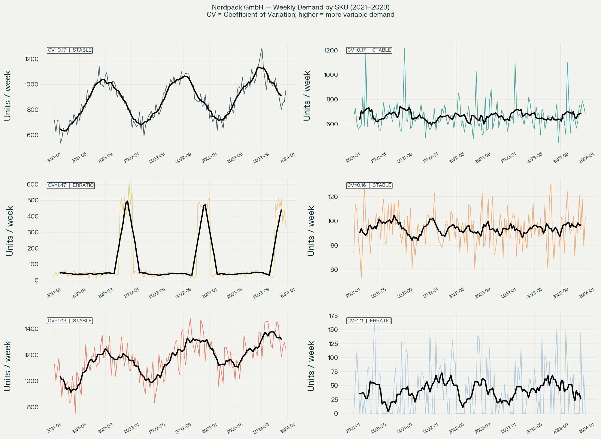

The horizontal axis shows time; the vertical axis shows units demanded per week. Thin coloured lines show observations, while the thick black line is an eight-week centred rolling average.

The panels distinguish smooth seasonality, promotional spikes and intermittent demand.

CV labels summarise overall variability. They do not measure forecast accuracy or distinguish predictable seasonality from unpredictable noise.

### 2. Yoghurt STL decomposition

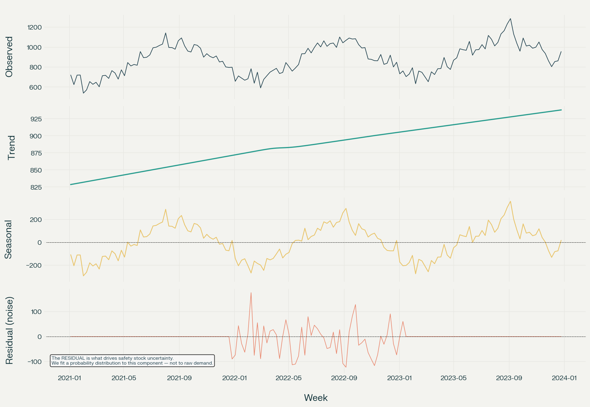

The four panels show observed demand, fitted trend, seasonal deviation and residual.

The dashed zero reference in the lower panels separates positive and negative deviations. The rising trend and repeating seasonal pattern describe the fitted sample.

Near-zero residuals at the beginning and end should not be interpreted as zero future uncertainty.

### 3. Christmas-cookie STL decomposition

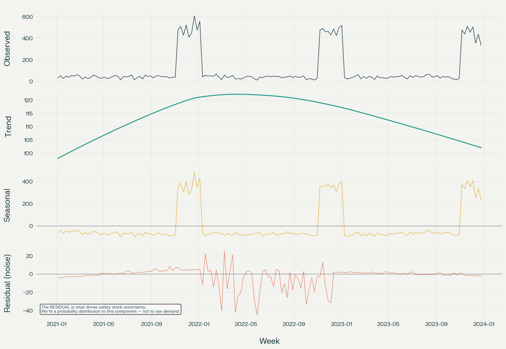

The observed and seasonal panels show concentrated year-end pulses.

The smoothed trend is a fitted decomposition component, not a direct operational forecast. A policy based on annual-average demand alone can obscure the timing of these concentrated requirements.

### 4. Residual distributions

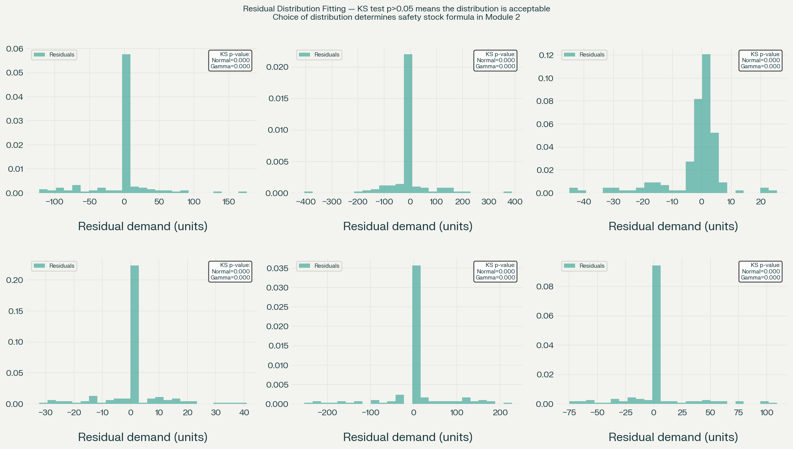

The horizontal axis is residual demand; the vertical axis is probability density, not a count of weeks.

Bars show the residual distribution. Parametric curves appear only when the plotting conditions allow them.

P-values displayed as 0.000 are rounded. The chart's acceptance language should be read cautiously: ordinary KS p-values are not calibrated here after fitting parameters to the same sample.

### 5. CV segmentation

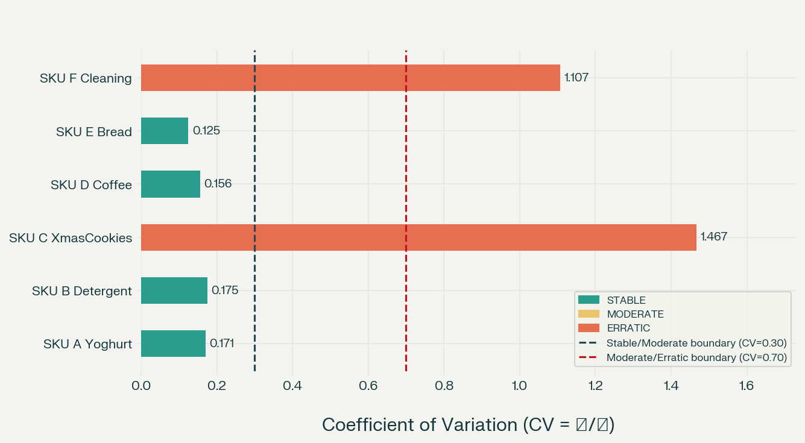

Horizontal bars show standard deviation divided by mean demand.

Reference boundaries at 0.30 and 0.70 define the project's stable, moderate and erratic categories.

These are project classification rules, not universal policy prescriptions. Strong seasonality can be operationally important even when aggregate CV is relatively low.

</details>

<details>
<summary>Module 2 — Inventory decisions: 5 figures</summary>

### 6. Type 1 versus Type 2

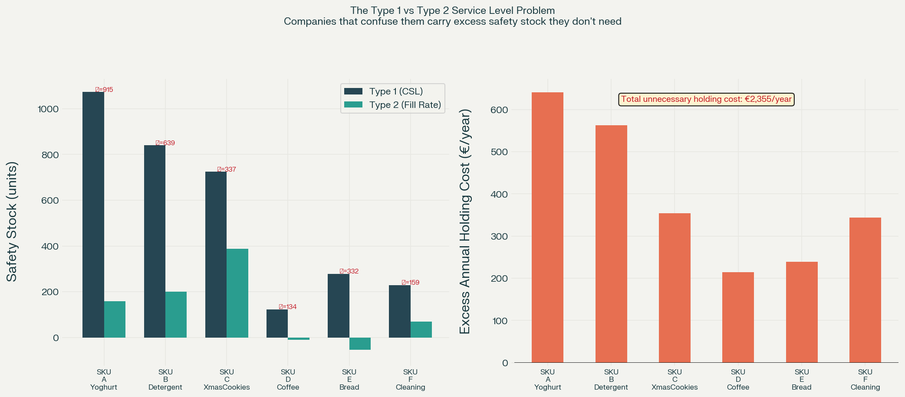

The left panel compares calculated safety stock. The right translates differences into annual holding cost using SKU-specific rates.

Dark and teal bars represent cycle service level and fill rate respectively.

The comparison shows different requirements in this experiment; it does not establish a universal ordering between the two policies.

### 7. Joint versus independent optimisation

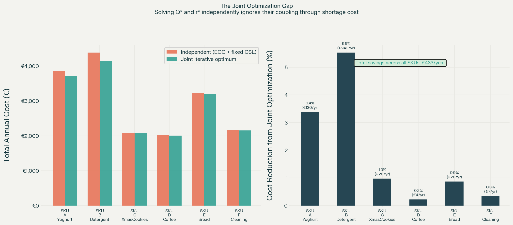

Paired bars compare modelled annual costs. The second panel expresses the difference as a percentage of the independent-policy cost.

The full-run reference improvement is approximately €433/year, with the largest individual saving for detergent.

A lower modelled cost does not establish compliance with an external service constraint.

### 8. Cost curves

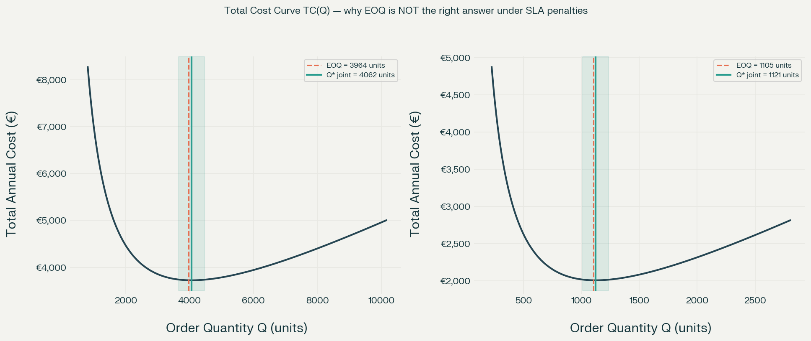

The horizontal axis is order quantity; the vertical axis is annual cost.

The dashed line marks EOQ, the solid teal line marks the joint solution, and the shaded band shows a ±10% neighbourhood around the latter.

The reorder point is held at its joint-solution value during this sweep. The graph is therefore a cost slice, not the fully re-optimised cost envelope.

The broad minimum illustrates that a small quantity change may have little economic effect.

### 9. Lead-time-demand distributions

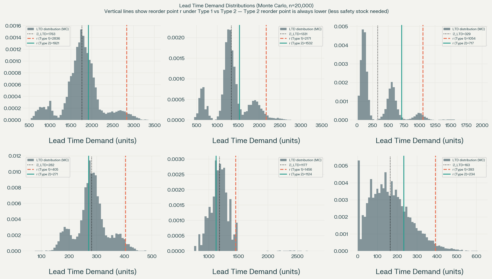

Bars show simulated total demand over sampled lead times. The dotted line marks mean LTD; the other lines mark reorder points for the two service definitions.

Multiple modes can arise from integer lead times and the demand mixture.

The historical sampling procedure does not preserve seasonal chronology.

### 10. Policy summary

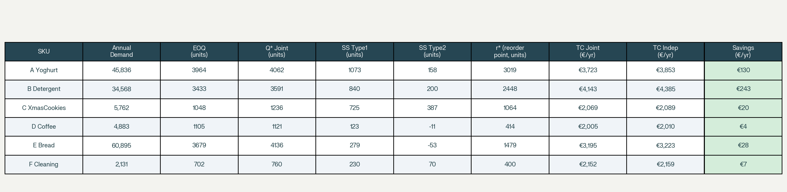

The table consolidates annual demand, EOQ, joint order quantity, service-specific safety stocks, reorder point and annual costs.

Type 1 and Type 2 safety stocks are separate comparisons; they should not be combined indiscriminately with the joint reorder point.

Bread's row is a non-perishable-model comparison, not its dedicated perishable recommendation.

</details>

<details>
<summary>Module 3 — Perishable bread: 5 figures</summary>

### 11. Demand and order benchmarks

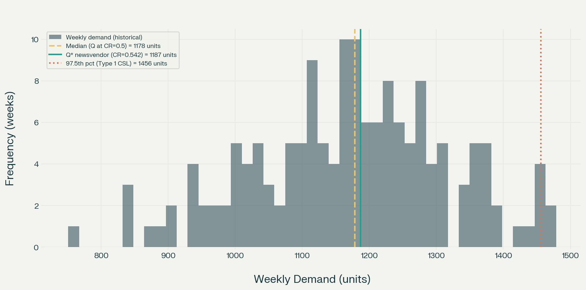

The histogram shows weekly demand frequencies.

Vertical lines identify the median, newsvendor quantity and high-percentile benchmark.

The reference newsvendor decision lies near the centre of the demand distribution because the assumed underage and overage costs produce a critical ratio near 0.54.

### 12. Expected-profit curve

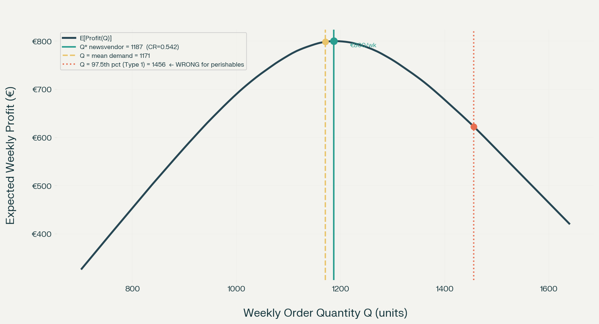

The horizontal axis is order quantity; the vertical axis is expected weekly profit.

The curve peaks near 1,187 units. Mean-demand ordering lies close to the economic optimum in this reference case, while the high-percentile policy generates substantially more waste.

The position of the maximum depends on the assumed economics.

### 13. Waste–stockout trade-off

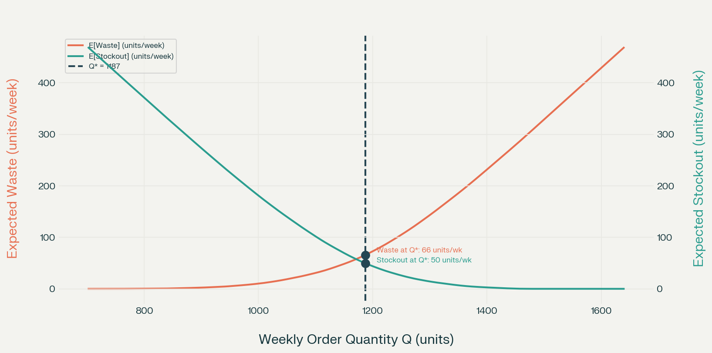

The orange curve uses the left axis for waste; the teal curve uses the right axis for unmet demand.

Both axes are measured in units per week. The vertical line marks the newsvendor quantity.

The optimum balances marginal economic consequences, not equal quantities of waste and shortages.

### 14. Critical-ratio sensitivity

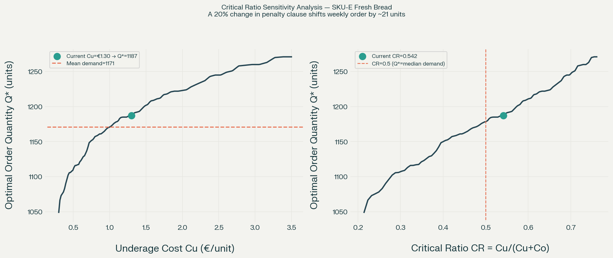

One panel varies underage cost; the other varies the critical ratio.

The highlighted point marks the reference assumption. Steps and changes in slope reflect empirical demand quantiles.

The sensitivity is local to the assumed demand sample and overage cost.

### 15. Policy comparison table

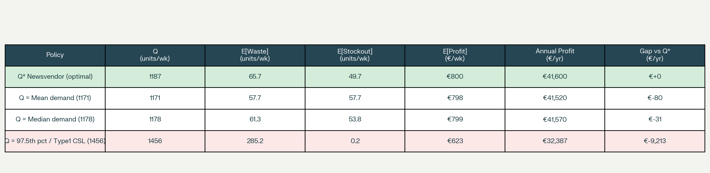

The rows compare the newsvendor, mean, median and high-percentile policies.

The table makes the economic trade-off explicit: fewer shortages can be purchased at the expense of more waste and lower profit.

Annual values use the model's 52-week annualisation.

</details>

<details>
<summary>Module 4 — Dock capacity: 5 figures</summary>

### 16. Utilisation and expected waiting

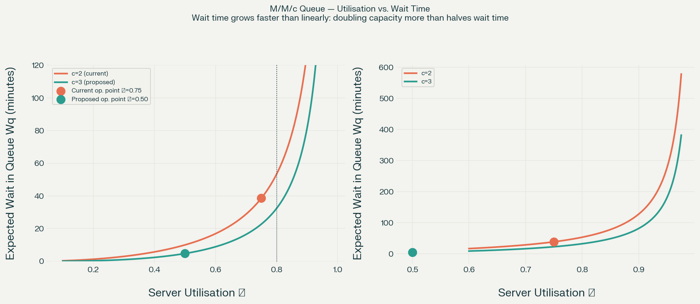

The horizontal axis is utilisation; the vertical axis is mean queue waiting time in minutes.

Curves represent dock-capacity configurations, and highlighted points identify the current and proposed cases.

The steep increase near saturation explains why a capacity increase can have a nonlinear effect on waiting.

### 17. Waiting-time distributions

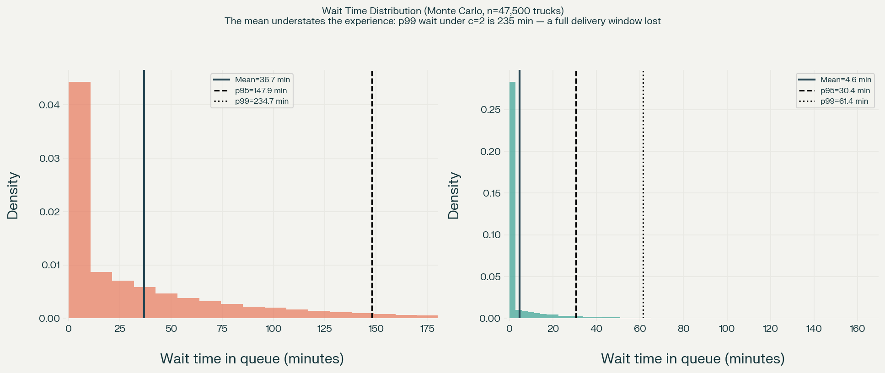

Histograms show simulated waiting-time densities. Vertical markers identify the mean and upper-tail percentiles.

This figure distinguishes an average delay from tail exposure.

Its percentiles describe the assumed queueing simulation, not measured truck arrival records.

### 18. Little's Law consistency illustration

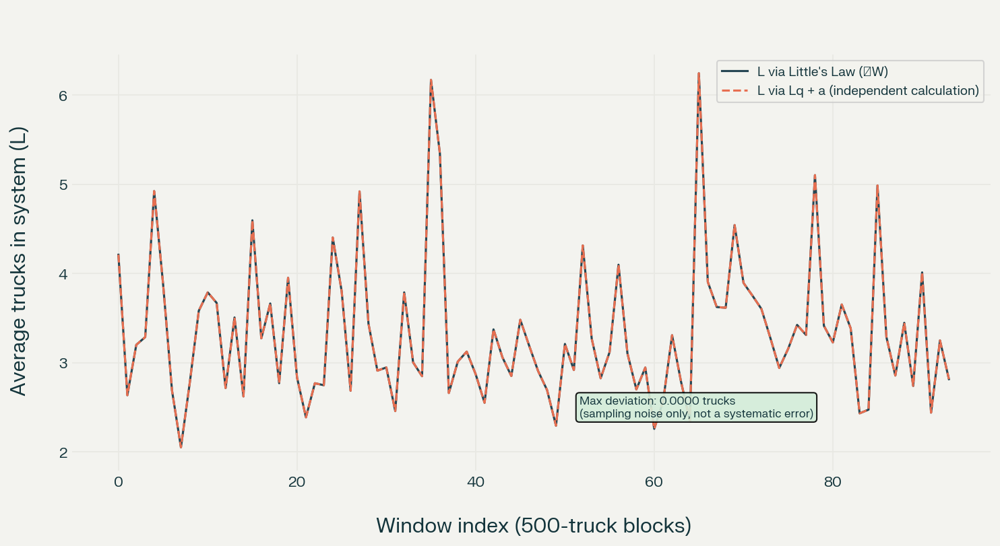

The horizontal axis indexes 500-truck blocks; the vertical axis shows average trucks in the system.

The two lines use the same wait samples and related expressions: λW and λWq + λ/μ.

Their agreement illustrates algebraic consistency. It is not an independent time-integrated occupancy measurement, despite stronger wording in the original chart.

### 19. Investment economics

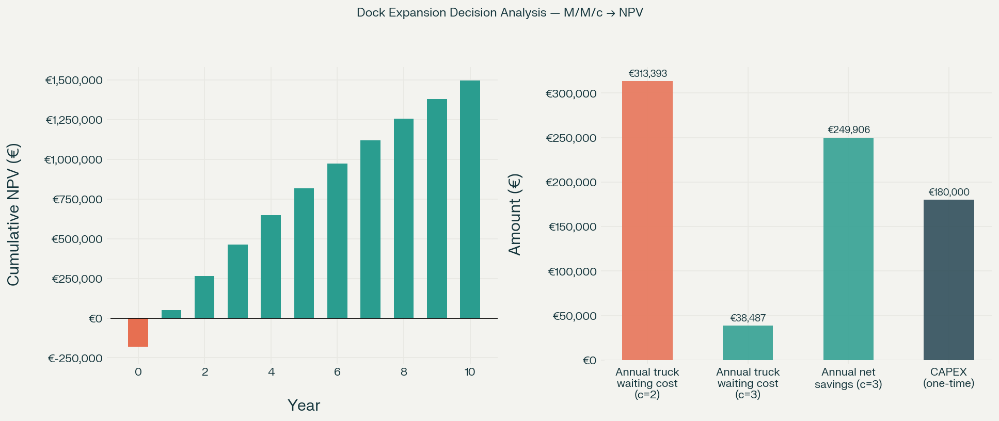

The cumulative-NPV panel shows how discounted benefits accumulate after capital expenditure.

The companion financial bars distinguish investment and annual operating economics.

Annual savings, one-off capex and multi-year NPV have different units of interpretation and should not be added together.

### 20. Dock-to-inventory linkage

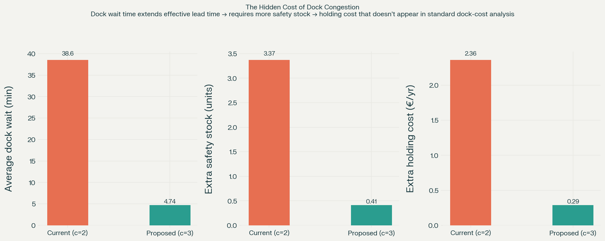

The panels translate waiting into additional lead time, mean LTD and illustrative holding cost.

The implementation approximates the inventory effect from the mean-delay change. It does not fully propagate queue-delay variance into an optimised inventory policy.

In the reference scenario, this secondary holding-cost effect is small relative to truck waiting cost.

</details>

<details>
<summary>Module 5 — Scenario analysis: 4 figures</summary>

### 21. SKU-level cost distribution

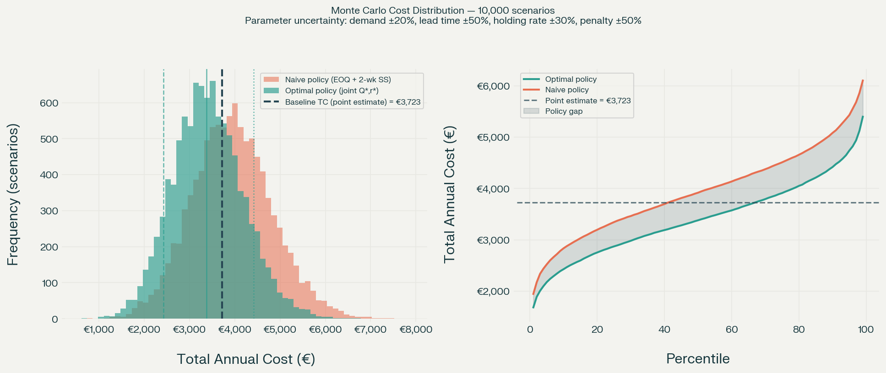

Overlapping histograms compare the adaptive joint policy with the rule-based alternative.

Vertical markers show baseline and percentile summaries. The companion percentile plot makes the distributional comparison easier to read.

Scenario spread is not a statistical confidence interval for a real warehouse's cost.

### 22. Tornado sensitivity

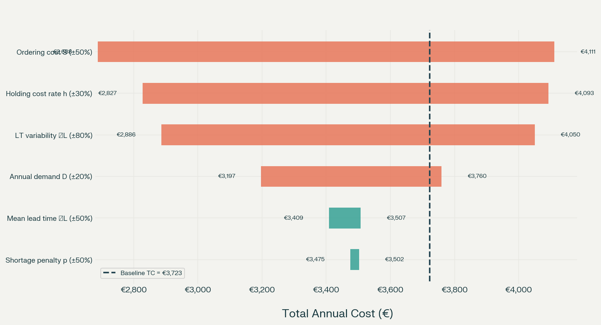

Horizontal bars show the cost range obtained by varying one input while holding the others at baseline.

Longer bars identify greater sensitivity within the specified input ranges.

This is not SHAP feature importance, a causal ranking or a measure of all interaction effects.

### 23. SLA breach by SKU

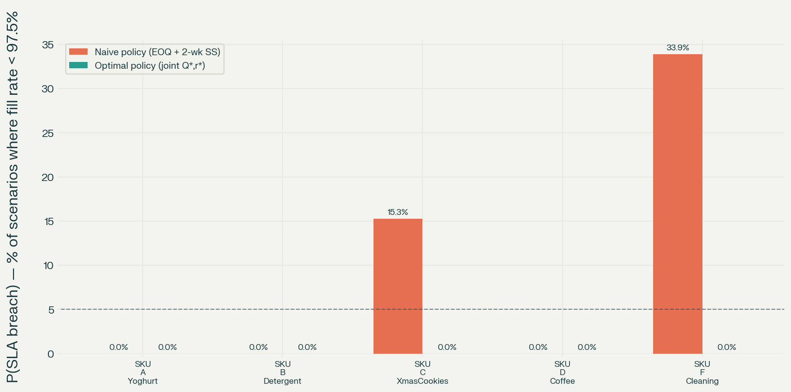

Paired bars report the percentage of scenarios in which the implemented fill-rate approximation falls below 97.5%.

The policy is re-optimised inside scenarios. Therefore the chart does not measure the robustness of a single fixed deployment policy.

A displayed zero is not evidence of zero operational stockout risk.

### 24. Aggregate cost distribution

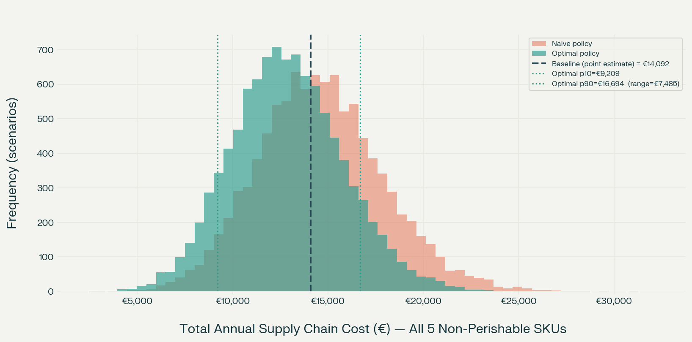

Histograms aggregate the five non-perishable SKU cost arrays. Vertical lines identify point-estimate and percentile comparisons.

Bread is excluded.

Scenario alignment and shared random-seed construction matter for interpreting cross-SKU dependence; this is not a calibrated supply-chain correlation model.

</details>

<details>
<summary>Module 6 — Recommendations: 4 figures</summary>

### 25. Recommendation table

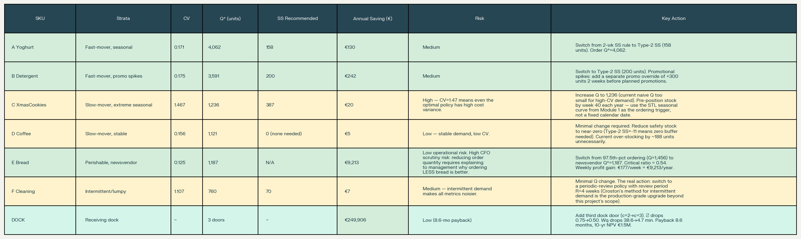

This is a decision-summary table rather than an additional optimisation result.

The current implementation uses hard-coded recommendation values. They must be reconciled with generated results before being treated as a current executive report.

In particular, bread profit must not be labelled as inventory cost.

### 26. Savings waterfall

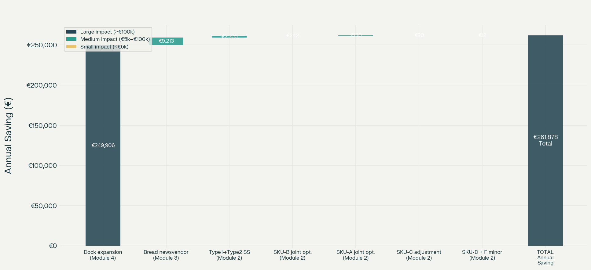

Floating bars show incremental contributions; the final bar shows the displayed total.

A waterfall is only as reliable as its intervention definitions and baseline reconciliation.

The current chart is an illustrative hard-coded business case, not proof that all component savings are additive.

### 27. Cost components and reorder-point response

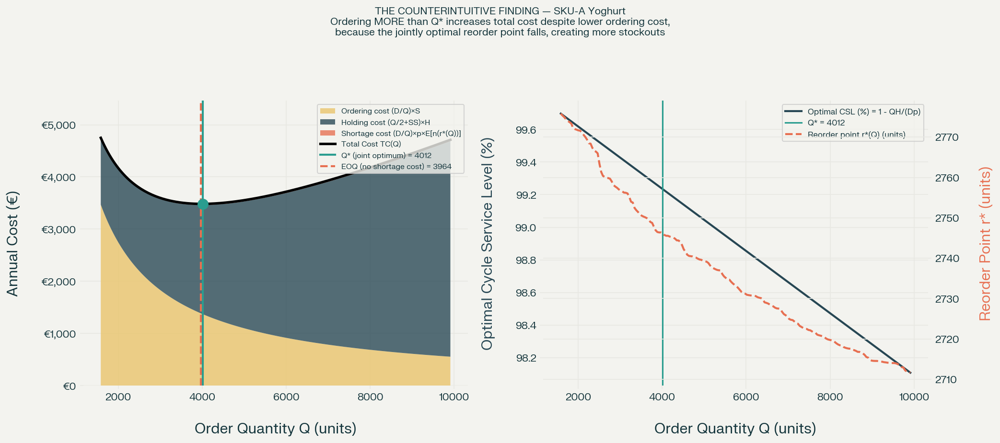

The first panel separates cost components and overlays their total as Q changes.

The second panel shows how the model's cost-optimal service level and reorder point respond.

Interpret the total curve and all cost components together. Do not assume that shortage cost alone explains every increase beyond the minimum.

### 28. Implementation roadmap

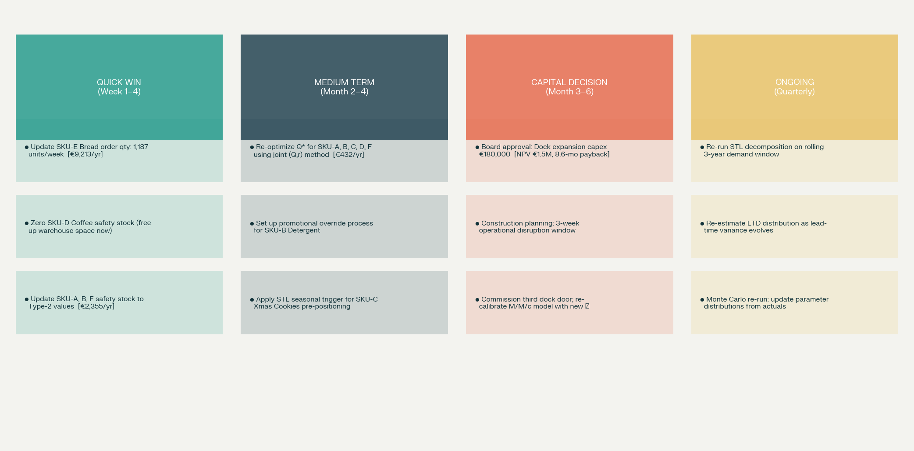

The columns group quick wins, medium-term work, capital decisions and ongoing review.

This is a proposed sequence, not an executed deployment plan.

Calendar timings, promotional overrides and construction disruption assumptions have not been operationally validated.

</details>

<details>
<summary>Historical single-SKU variants: 2 additional images</summary>

### 29. Single-SKU joint-cost comparison


This alternate image reports approximately €125/year of improvement for one yoghurt fixture.

It is not the six-SKU reference result and must not replace the full-run €433 comparison.

### 30. Single-SKU service-definition comparison


This alternate image reports approximately €633/year of holding-cost difference for its fixture.

It uses a different scope from the six-SKU €2,355 reference chart.

These two images are preserved for provenance, not presented as additional independent findings.

</details>

---

## Run locally

### Requirements

Use Python 3.12, matching the Docker image and validation workflow.

From the repository root:

```bash
git clone [https://github.com/pro-nine/opti-inven-ops.git](https://github.com/pro-nine/opti-inven-ops.git)
cd opti-inven-ops

python -m venv .venv
```

Activate the environment:

```bash
# macOS / Linux
source .venv/bin/activate

# Windows PowerShell
.venv\Scripts\Activate.ps1
```

Install dependencies:

```bash
python -m pip install --upgrade pip
python -m pip install -r Requirements.txt pytest
```

Run the analytical case study:

```bash
python -m src.run_all
```

Run the data-platform pipeline:

```bash
python -m data_platform.pipeline
```

Run validation:

```bash
python -m pytest -q
python -m src.robustness
```

Dependency filenames are case-sensitive on Linux: use `Requirements.txt`.

Fixed seeds support repeatability for fresh executions. Repeated calls within one interpreter can advance module-level random generators, and dependency versions can affect numerical output.

---

## Run with Docker

Build the image:

```bash
docker build -t opti-inven-ops .
```

Run its default data-platform pipeline:

```bash
docker run --rm opti-inven-ops
```

Without a volume mount, files generated inside the removed container are not retained on the host.

To retain generated data on macOS/Linux, use the existing populated data directory:

```bash
docker run --rm \
  -v "$(pwd)/data:/app/data" \
  opti-inven-ops
```

Back up source inputs first. The analytical run generates demand data, so the current workflow should not be treated as a safe production transformation of an immutable external source.

To run tests inside a temporary container:

```bash
docker run --rm \
  -e PYTHONPATH=/app \
  -e MPLBACKEND=Agg \
  opti-inven-ops \
  sh -ec 'python -m pip install pytest &&
          python -m pip check &&
          python -m pytest -q'
```

The temporary test command installs pytest into the container; it is not part of the application dependency list.

---

## Data platform outputs

| Output | Purpose |
|---|---|
| `data/demand_weekly.csv` | Wide-format demand input/generated case-study data |
| `data/warehouse.duckdb` | Local analytical warehouse |
| `data/powerbi/` | CSV exports for downstream BI consumption |
| `outputs/figures/` | Runtime analytical figures |
| `outputs/validation/` | Robustness reports |
| `docs/assets/` | Versioned documentation figures |

Core warehouse tables include:

- `raw_demand`: source data in its original wide structure.
- `demand`: long-format date, SKU and demand observations.
- `demand_summary`: SKU-level descriptive statistics.
- Analytics tables discovered from generated CSV files.
- `run_log`: persistent run records.

Run records include identifiers, status, timestamps, duration, counts and failure details.

Persistence depends on reusing the database file. Fresh CI runners and disposable containers do not automatically retain history.

The CSV-discovery adapter currently identifies newly created paths. An existing output file that is overwritten may not be rediscovered on a later run. Repeat-run completeness therefore requires further work.

The platform loads its source before running analytics, while Module 1 generates demand again. These two datasets can diverge if the original source differs from the generated case study. A production design should pass one explicit input dataset through the complete pipeline.

---

## Testing and validation

The repository includes checks for:

- Data-platform behaviour.
- Persistent success/failure run records.
- Legacy run-log migration.
- Warehouse rollback.
- Standalone demand fitting with frozen CDFs.
- Standalone demand-module execution.
- A separate weekly policy simulation with random lead times and warm-up exclusion.
- Host and container execution through GitHub Actions.

The validation workflow also builds the image and executes the default container pipeline.

### What green CI does not establish

A successful workflow establishes that its configured checks completed successfully.

It does not establish:

- Real-world financial savings.
- Forecast accuracy.
- SLA compliance for every recommended policy.
- Correctness of every chart title or hard-coded summary.
- End-to-end validation of Module 2's recommendations in weekly execution.

The current weekly simulation tests use a separate helper rather than consuming the optimiser's policy outputs. The helper also reports a placeholder order-count value. That test coverage should be strengthened before claiming complete operational policy validation.

---

## Limitations

1. All demand and operating assumptions are synthetic.
2. Only three annual demand cycles are available.
3. Decomposition is in-sample, not a chronological forecast evaluation.
4. Historical demand resampling in Module 2 discards seasonal order.
5. Distribution-test diagnostics require caution after parameter fitting.
6. Inventory formulas use simplifying replenishment and shortage assumptions.
7. A cost optimum is not automatically an SLA-constrained optimum.
8. Bread's single-period model does not represent all shelf-life and replenishment complexities.
9. Queueing results depend on assumed arrivals, service behaviour and stability.
10. The Little's Law chart is an algebraic consistency illustration.
11. Monte Carlo analysis uses scaled LTD approximations and scenario re-optimisation.
12. Executive recommendation values are partly hard-coded.
13. Inventory benefits may overlap and should not be summed without reconciliation.
14. The platform needs stronger input lineage and repeat-run output discovery.
15. Dependency ranges are not a fully locked reproducibility environment.

These limitations define the next engineering and modelling improvements; they are not hidden by successful execution tests.

---

## Project structure

```text
opti-inven-ops/
├── .github/workflows/
│   ├── data-platform.yml
│   └── validation.yml
├── src/
│   ├── demand_compat.py
│   ├── module1_demand.py
│   ├── module2_inventory.py
│   ├── module3_newsvendor.py
│   ├── module4_queuing.py
│   ├── module5_montecarlo.py
│   ├── module6_recommendations.py
│   ├── robustness.py
│   └── run_all.py
├── data_platform/
├── tests/
├── data/
├── docs/
│   ├── VALIDATION.md
│   └── assets/                  # Documentation assets to publish
├── outputs/                    # Generated at runtime
├── Dockerfile
├── docker-compose.yml
├── Requirements.txt
├── README.md
└── README_DATA_PLATFORM.md
```

---

## Further documentation

- [Data platform guide](README_DATA_PLATFORM.md)
- [Validation notes](docs/VALIDATION.md)
- [Analytical source](src/)
- [Tests](tests/)

The root README provides the project narrative. Supporting documents provide deeper implementation details without duplicating the introduction.
